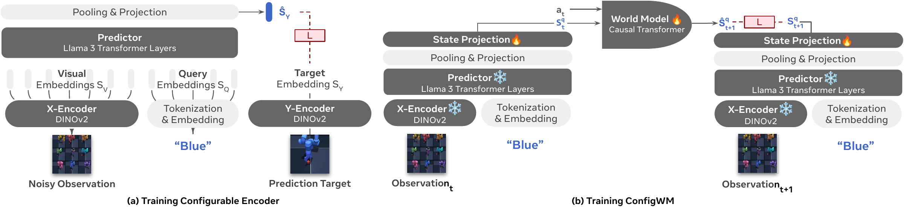
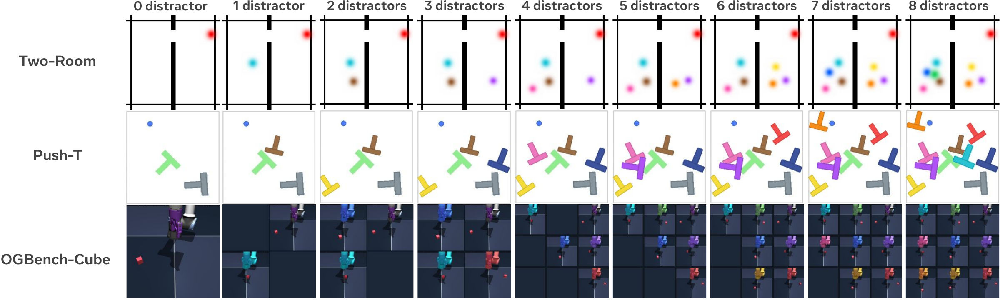
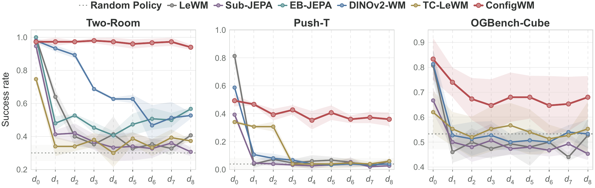

<div align="center">

# ConfigWM: World Models with Configurable Perception

<p>
  <a href="https://yijunshens.github.io/">Yijun Shen</a><sup>1,*</sup> &nbsp;&nbsp;
  <a href="https://chendelong.world/">Delong Chen</a><sup>2,*</sup> &nbsp;&nbsp;
  <a href="https://www.semanticscholar.org/author/Xianming-Hu/2276742198">Xianming Hu</a><sup>1</sup> &nbsp;&nbsp;
  <a href="https://faculty.ecnu.edu.cn/_s16/zk2/main.psp">Kai Zhang</a><sup>1,†</sup> &nbsp;&nbsp;
  <a href="https://scholar.google.com/citations?hl=en&amp;user=QEMJWzEAAAAJ">Pascale Fung</a><sup>2</sup>
</p>

<p>
   <sup>1</sup> East China Normal University &nbsp;&nbsp;&nbsp;
   <sup>2</sup> HKUST
</p>

<p>
  <sup>*</sup> Equal contribution &nbsp;&nbsp;&nbsp; <sup>†</sup> Corresponding author<br>
  <a href="mailto:kzhang@cs.ecnu.edu.cn">kzhang@cs.ecnu.edu.cn</a>
</p>

[**🔗 Project Website**](https://configwm.github.io) | [**📄 Read the Paper**](https://arxiv.org/abs/2610.27914) | [**🤗 Download Dataset**](https://huggingface.co/datasets/YijunShen/ConfigWM)

</div>

---

## 📖 Introduction

Real-world observations often contain abundant task-irrelevant information. Effective world modeling and planning thus require abstracting observations into state representations that filter out irrelevant information. However, encoders in existing world models are typically task-agnostic, leading to state representations that are easily contaminated by task-irrelevant information. As a result, the model may not adaptively filter observations to cater to different task demands.

To solve this problem, we introduce **ConfigWM**, which realizes configurable perception through task-conditioned state extraction. Given a language description of the task at hand, ConfigWM steers how task-agnostic embeddings are mapped into a task-conditioned state space, where action-conditioned dynamics are learned for planning.

[](assets/method.pdf)

To evaluate ConfigWM, we augment three environments (**Two-Room, Push-T, and OGBench-Cube**) with increasing numbers of dynamic, target-like distractors. Each environment contains nine distraction levels, allowing us to systematically evaluate world models under increasingly challenging visual conditions.

[](assets/noisy_world.pdf)

Existing world models generally experience declining planning success as dynamic distraction increases. In contrast, **ConfigWM maintains comparatively stable performance**, achieving an average improvement of **22.7 percentage points** over the strongest baseline in each environment, averaged across the three environments.

[](assets/planning_performance.pdf)

---

## ⚙️ 1. Setup

The environment includes Python 3.12 and PyTorch 2.8.0.

```bash
git clone https://github.com/yijunshens/ConfigWM.git
cd ConfigWM
conda env create -f environments/configwm.yml
conda activate configwm
python -m pip install -r requirements/eval.txt
python -m pip install ./third_party/stable-worldmodel
```

OGBench-Cube evaluation requires `libEGL` and an EGL-capable NVIDIA driver. On Ubuntu, install the library with `sudo apt-get install libegl1`.

## 📥 2. Download data

The examples below use **Two-Room, d3**. Run all commands from the repository root.

```bash
python tools/download_data.py --repo YijunShen/ConfigWM --local-dir ../configwm-data \
  --env tworoom --task configwm --variant d3
```

Use `pusht`, `tworoom`, or `ogbcube` for the environment, and `d0` through `d8` for the distraction level. To download the entire dataset instead (approximately 1.64 TB):

```bash
hf download YijunShen/ConfigWM --repo-type dataset --local-dir ../configwm-data
```

## 🚀 3. Train ConfigWM

### Path 1: Use a pretrained Configurable Encoder

Choose a Configurable Encoder from our dataset repository:

| Configurable Encoder | Download |
| --- | --- |
| Push-T | [pusht](https://huggingface.co/datasets/YijunShen/ConfigWM/tree/main/ckpts/pusht) |
| Two-Room | [tworoom](https://huggingface.co/datasets/YijunShen/ConfigWM/tree/main/ckpts/tworoom) |
| OGBench-Cube | [ogbcube](https://huggingface.co/datasets/YijunShen/ConfigWM/tree/main/ckpts/ogbcube) |
| Unified (all three environments) | [unified](https://huggingface.co/datasets/YijunShen/ConfigWM/tree/main/ckpts/unified) |

Download the Two-Room configurable encoder and train ConfigWM:

```bash
hf download YijunShen/ConfigWM --repo-type dataset \
  --include "ckpts/tworoom/*" --local-dir .

bash launch/train_configwm.sh \
  --env tworoom --gpus 0 \
  --data-root ../configwm-data \
  --dino-path facebook/dinov2-small \
  --encoder-checkpoint ./ckpts/tworoom \
  --output-dir ./outputs/configwm/tworoom/d3 \
  --batch-size 512 --variant d3
```

For another environment, replace `tworoom` in the download and checkpoint path with `pusht`, `ogbcube`, or `unified`. Match the training environment to your data; the unified encoder works with any of the three environments.

### Path 2: Train a Configurable Encoder first

```bash
python tools/download_data.py --repo YijunShen/ConfigWM --local-dir ../configwm-data \
  --env tworoom --task configurable_encoder

bash launch/train_configurable_encoder.sh \
  --env tworoom --gpus 0,1 \
  --data-root ../configwm-data \
  --vision-model facebook/dinov2-small \
  --predictor-model alpindale/Llama-3.2-1B \
  --output-dir ./outputs/configurable_encoder/tworoom
```

After one epoch, use the saved `outputs/configurable_encoder/tworoom/checkpoint-<step>` folder in place of `./ckpts/tworoom` in the ConfigWM training command above.

ConfigWM saves `configwm.pt` and `config.json` under the output directory.

## 📊 4. Evaluate

```bash
python tools/download_data.py --repo YijunShen/ConfigWM --local-dir ../configwm-data \
  --env tworoom --task control --variant d3
```

### Evaluate all checkpoints

```bash
CUDA_VISIBLE_DEVICES=0 bash launch/eval_configwm.sh \
  --env tworoom --variant d3 --data-root ../configwm-data \
  --run-dir ./outputs/configwm/tworoom/d3 \
  --seed 42 --num-eval 50 --output ./outputs/configwm/tworoom/d3/eval.json
```

This evaluates all saved checkpoints in the output directory with the same seed and reports each score.

### Evaluate a single checkpoint

```bash
CUDA_VISIBLE_DEVICES=0 bash launch/eval_configwm.sh \
  --env tworoom --variant d3 --data-root ../configwm-data \
  --run-dir ./outputs/configwm/tworoom/d3/epoch03 \
  --checkpoint ./outputs/configwm/tworoom/d3/epoch03/configwm.pt \
  --seed 42 --num-eval 50 --output ./outputs/configwm/tworoom/d3/epoch03/eval.json
```

See [configs/](configs/) for more training settings.


## 🖼️ 5. Real-World Perception

Train a Configurable Encoder with DINOv2, DINOv3, LingBot-Vision, or V-JEPA2.1.
Prepare image pairs and a `manifest.jsonl` with `source`, `target`, and `query`,
following the [example dataset](examples/realworld/).

The full [real-world collection](https://huggingface.co/datasets/YijunShen/ConfigWM/tree/main/realworld) is available with [download and training instructions](docs/realworld.md#use-the-released-data).

Try one training step on the example:

```bash
bash launch/train_configurable_encoder.sh \
  --env realworld --gpus 0 --data-root ./examples/realworld \
  --backbone dinov2-small \
  --predictor-model alpindale/Llama-3.2-1B \
  --group-size 6 --steps 1 --output-dir ./outputs/configurable_encoder/example
```

For your own data, change `--data-root` and omit `--steps 1`.
See the [usage guide](docs/realworld.md) for data preparation and other backbones.

## 📄 Citation

```bibtex
@misc{shen2026configwm,
      title={World Models with Configurable Perception},
      author={Yijun Shen and Delong Chen and Xianming Hu and Kai Zhang and Pascale Fung},
      year={2026},
      eprint={2610.27914},
      archivePrefix={arXiv},
      primaryClass={cs.CV},
      url={https://arxiv.org/abs/2610.27914},
}
```

## 🙏 Acknowledgments

We would like to thank Willy Chung, Quentin Garrido, Basile Terver for providing valuable feedback to this work.

## 📬 Contact

For questions or inquiries, please feel free to reach out to [51285901087@stu.ecnu.edu.cn](mailto:51285901087@stu.ecnu.edu.cn).
