# Real-world image-pair examples

Six pairs from six different datasets in our real-world training collection. Source images contain added distractors; target images are the corresponding original frames. Task descriptions are unchanged.

| Source | Target | Task / original collection |
| --- | --- | --- |
| 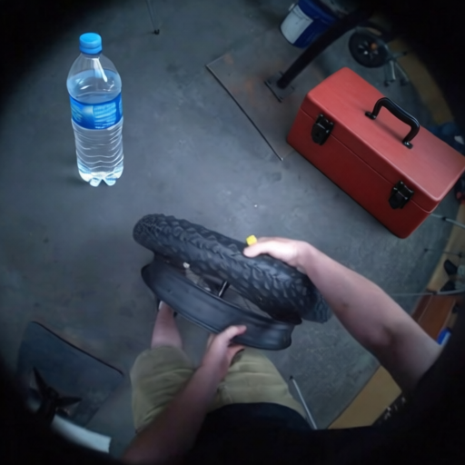 | 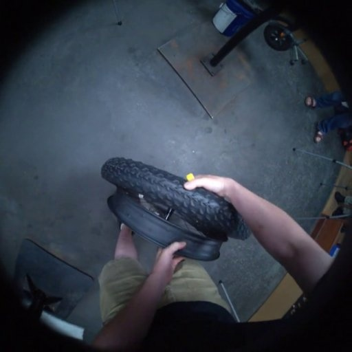 | lift the wheel off the feet with both hands egocentric/egoexo4d-atomic |
| 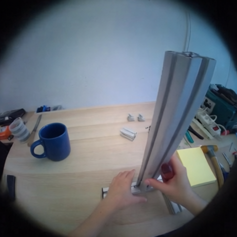 | 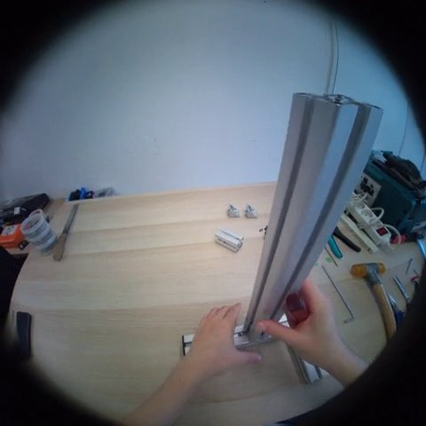 | attach the vertical bar egocentric/indego |
| 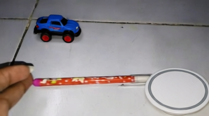 | 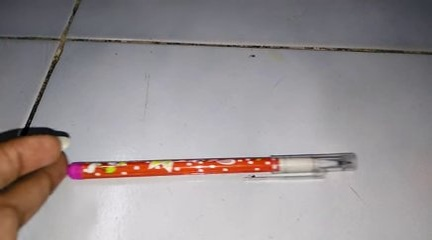 | push pencil from left to right egocentric/ssv2 |
| 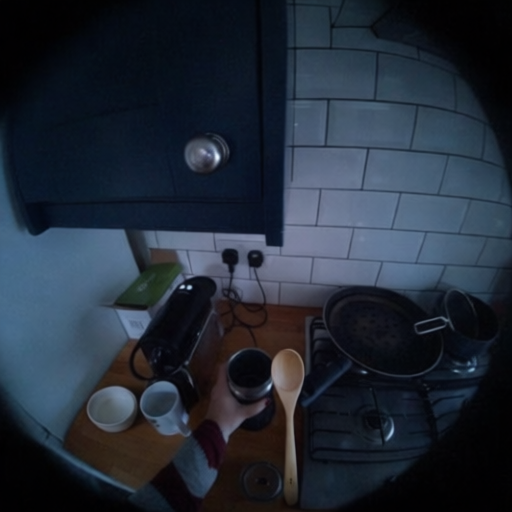 | 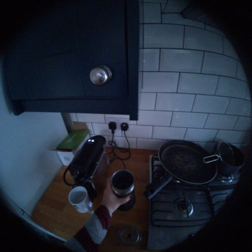 | slide the milk frother and its base on the counter to get it closer to where the person is standing egocentric/hdepic |
| 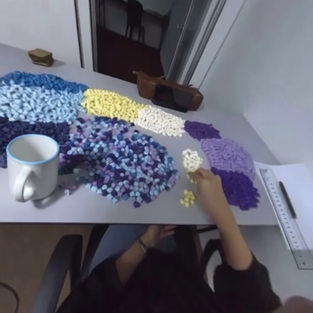 | 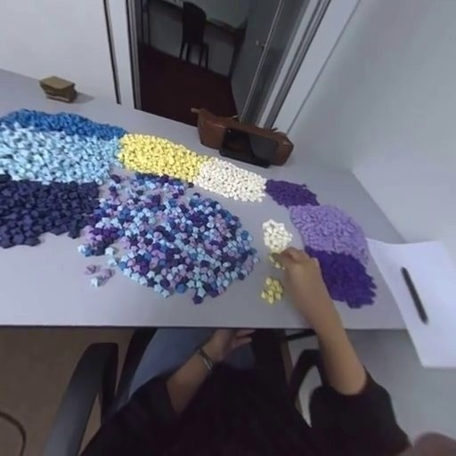 | gather and move the yellow paper stars from the scattered pile onto the main sorting area with the hand egocentric/xperience10m-stereo |
| 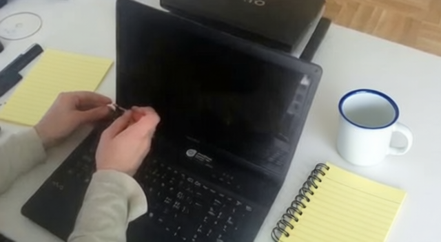 | 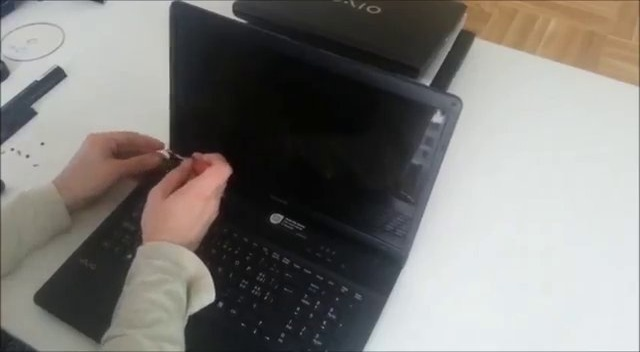 | watch someone unscrewing the screws used to fix the screen internet/coin-step |

See [manifest.jsonl](manifest.jsonl) for the records and the [usage guide](../../docs/realworld.md) to train with your own images.
